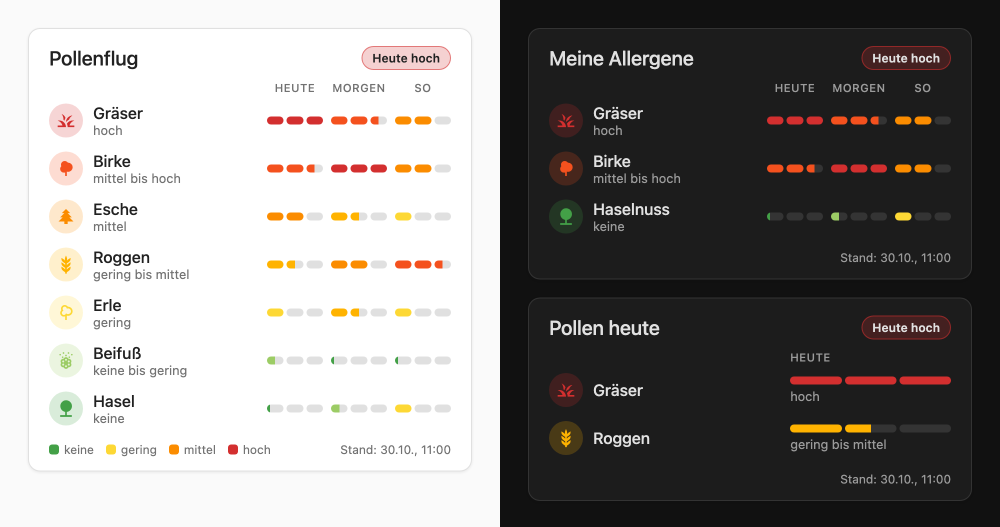

# Pollenflug Card für Home Assistant

[](https://hacs.xyz/docs/faq/custom_repositories/)
[](https://github.com/Ga-Re/Pollenflug/releases)
[](https://github.com/Ga-Re/Pollenflug/actions/workflows/validate.yml)

Zeigt die Pollenflugvorhersage des Deutschen Wetterdienstes (DWD) für **heute, morgen und übermorgen**:
pro Pollenart ein farbiger Balken (0 = keine … 3 = hoch, in halben Stufen), oben ein Hinweis auf die
höchste Belastung des Tages. Ein Klick auf eine Zeile öffnet den Detail-Dialog des Sensors.

Die Card wird komplett über die Oberfläche eingerichtet – **YAML ist nicht nötig**.



## Voraussetzung: Daten

Die Card zeigt nur an. Die Daten liefert die HACS-Integration
**[DWD Pollenflug](https://github.com/mampfes/hacs_dwd_pollenflug)**:

1. In HACS nach „DWD Pollenflug“ suchen, installieren und Home Assistant neu starten.
2. *Einstellungen → Geräte & Dienste → Integration hinzufügen → DWD Pollenflug*, dann deine Region wählen.

## Installation über HACS (empfohlen)

1. HACS öffnen → ⋮ (oben rechts) → **Benutzerdefinierte Repositories**.
2. Repository: `https://github.com/Ga-Re/Pollenflug`, Typ: **Dashboard** → *Hinzufügen*.
   (Nicht „Integration“ wählen – sonst meldet HACS „Repository structure … is not compliant“.)
3. In HACS nach **„Pollenflug Card“** suchen → *Herunterladen*.
4. Browser neu laden. HACS trägt die Ressource automatisch ein und meldet künftige Updates.

## Manuelle Installation

1. `pollenflug-card.js` aus dem [neuesten Release](https://github.com/Ga-Re/Pollenflug/releases/latest)
   nach `/config/www/pollenflug-card.js` kopieren (Ordner `www` ggf. anlegen).
2. *Einstellungen → Dashboards → ⋮ (oben rechts) → Ressourcen → Ressource hinzufügen*
   - URL: `/local/pollenflug-card.js`
   - Typ: **JavaScript-Modul**
3. Browser neu laden (ggf. Cache leeren bzw. in der App „Frontend-Cache zurücksetzen“).

## Card hinzufügen und einstellen

1. Dashboard öffnen → *Bearbeiten* → *Karte hinzufügen* → nach **„Pollenflug“** suchen.
2. Im Editor einstellen – die Vorschau aktualisiert sich sofort:

| Einstellung | Was sie macht |
| --- | --- |
| **Titel** | Überschrift der Karte; leer lassen für keine Überschrift |
| **Welche Pollen?** | *Alle gefundenen Pollen-Sensoren* oder *Nur ausgewählte Sensoren* |
| **Region** | Bei „alle gefundenen“: auf eine Region beschränken |
| **Ausgewählte Sensoren** | Bei „nur ausgewählte“: Sensoren hinzufügen, entfernen, mit Pfeilen sortieren, optional eigenen Namen und eigenes Symbol vergeben |
| **Vorhersage für morgen und übermorgen** | Aus: nur heute, dafür mit Text („mittel bis hoch“) |
| **Pollen ohne Belastung ausblenden** | Blendet Pollen aus, die an keinem der Tage fliegen |
| **Farblegende / Datenstand** | Zusätzliche Infos unten in der Karte |
| **Reihenfolge** | Stärkste Belastung zuerst, alphabetisch oder wie ausgewählt |
| **Erweitert** | Nur für andere Datenquellen: Sensor-Präfix und Attributnamen für die Vorhersage |

Tipp: Wechselst du auf *Nur ausgewählte Sensoren*, übernimmt der Editor alle bisher angezeigten
Sensoren. Du musst dann nur noch die entfernen, auf die du nicht allergisch bist.

## Für Fortgeschrittene: YAML (optional)

Was der Editor speichert, lässt sich auch im Code-Editor der Karte sehen und ändern, z. B.:

```yaml
type: custom:pollenflug-card
title: Meine Allergene
hide_inactive: true
entities:
  - sensor.pollenflug_birke_31
  - entity: sensor.pollenflug_hasel_31
    name: Haselnuss
```

Weitere Schlüssel: `region`, `show_forecast`, `show_legend`, `show_last_update`,
`sort` (`level` | `name` | `none`), `entity_prefix`, `attributes.tomorrow`, `attributes.day_after`.

## Demos ohne Home Assistant

- `demo.html` – verschiedene Varianten der Card mit Beispieldaten
- `demo-editor.html` – Editor und Vorschau nebeneinander (vereinfachte Nachbildung der HA-Eingabefelder)

Beide brauchen einen lokalen Webserver, z. B. `python3 -m http.server` im Ordner der Dateien,
dann `http://localhost:8000/demo.html` öffnen.

## Neues Release erstellen

1. Änderungen in [`CHANGELOG.md`](CHANGELOG.md) unter einem neuen Abschnitt `## [1.2.0] - JJJJ-MM-TT`
   beschreiben und committen.
2. `./scripts/release.sh 1.2.0` ausführen. Das Skript setzt die Version in `pollenflug-card.js`,
   committet, legt den Tag `v1.2.0` an und pusht.
3. Der Workflow *Release* prüft, dass Tag, Version und Changelog zusammenpassen, und erstellt das
   GitHub-Release mit `pollenflug-card.js` als Anhang. HACS bietet das Update danach automatisch an.

Versionen mit Bindestrich (z. B. `1.2.0-beta.1`) werden als Vorabversion veröffentlicht.

## Lizenz

[MIT](LICENSE)
